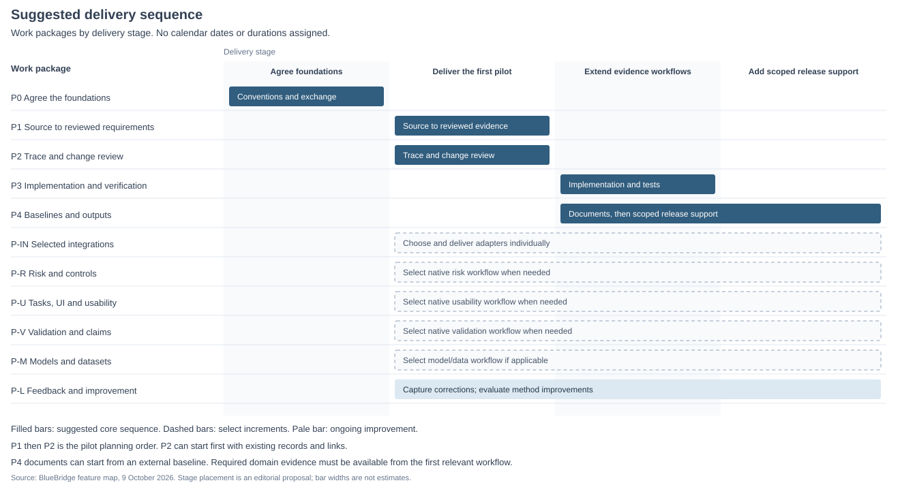
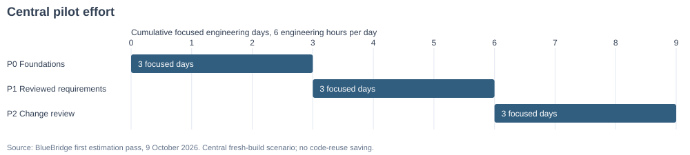

# BlueBridge tasks, work packages and roadmap

## Tasks cutting across packages

Discussion proposal. Subtasks are ranked roughly by colleague effort, not measured timings. Capability counts describe selected scope, not progress or savings. Hard prerequisites are included; scope-dependent requirements remain explicit.

### 1. Define and maintain product needs and requirements

A colleague turns source material into reviewed needs and testable requirements with supporting evidence and recorded decisions.

1. Interpret source material and agree the needs. Internal support: Capture exact passages, track clarification questions and produce cited candidate needs for review. Selected capabilities: CAP-06, CAP-10, CAP-11, CAP-13, CAP-18.
2. Derive and review testable requirements. Internal support: Draft requirements from reviewed needs, check and revise them, and separately review their proposed links. Selected capabilities: CAP-11, CAP-12, CAP-14, CAP-18.
3. Maintain accepted versions and trace coverage. Internal support: Retain decisions and versions, inspect defined coverage gaps and retrieve the accepted records. Selected capabilities: CAP-02, CAP-04, CAP-14, CAP-15, CAP-38.

People retain: People resolve domain ambiguity, independently inspect the evidence and decide what to accept.

- P0: CAP-01 Record scope, evidence homes, and decision responsibilities [Shared prerequisite]; CAP-02 Identify and retain exact record versions [Core task scope]; CAP-03 Define trace meanings and allowed relationships [Shared prerequisite]; CAP-04 Record human decisions and return work for revision [Core task scope]; CAP-05 Version processing instructions and retain run provenance [Shared prerequisite]; CAP-38 Exchange records and preserve a handover path [Core task scope].
- P1: CAP-06 Capture source material manually with citations [Core task scope]; CAP-07 Extract source text from documents [Later addition]; CAP-10 Ask and resolve clarification questions [Core task scope]; CAP-11 Draft needs and requirements from agreed evidence [Core task scope]; CAP-12 Check and revise the worker's draft [Core task scope]; CAP-13 Find and assemble relevant existing evidence [Core task scope]; CAP-14 Propose and review trace-link changes [Core task scope]; CAP-18 Independently check a candidate or change [Core task scope].
- P2: CAP-15 Inspect traceability and identify defined coverage gaps [Core task scope]; CAP-16 Coordinate a change and its follow-up work [Later addition]; CAP-19 Suggest missing relationships and unlinked impacts [Later addition]; CAP-20 Detect source and implementation drift [Later addition].
- P-IN: CAP-08 Capture selected Slack discussions [Later addition]; CAP-09 Capture meeting transcripts and associated notes [Later addition].
- P-R: CAP-27 Support risk analysis, controls, and residual-risk review [Scope-dependent].
- P-U: CAP-28 Support tasks, UI requirements, and usability evidence [Scope-dependent].
- P-L: CAP-35 Capture corrections and failure feedback [Shared prerequisite]; CAP-36 Review recurring corrections and failures [Later addition]; CAP-37 Evaluate and adopt improved working methods [Later addition].

### 2. Assess and manage product risks

A risk reviewer maintains risks and controls, inspects their supporting evidence and records a residual-risk decision.

1. Analyse hazards, define controls and assess residual risk. Internal support: Maintain or reference risk analyses, assumptions, controls, supporting evidence and named decisions. Selected capabilities: CAP-27, CAP-13, CAP-18.
2. Review evidence of implementation and effectiveness. Internal support: Connect control requirements to implementation and reviewed test executions, with evidence gaps visible. Selected capabilities: CAP-27, CAP-21, CAP-26, CAP-15, CAP-18.
3. Maintain links and coordinate risk-related updates. Internal support: Review risk-to-requirement/test links, trace known change consequences and assign follow-up. Selected capabilities: CAP-27, CAP-14, CAP-16, CAP-17.

People retain: Domain experts analyse hazards, judge control effectiveness and make the risk decision. Record support does not automate that judgement.

- P0: CAP-01 Record scope, evidence homes, and decision responsibilities [Shared prerequisite]; CAP-02 Identify and retain exact record versions [Shared prerequisite]; CAP-03 Define trace meanings and allowed relationships [Shared prerequisite]; CAP-04 Record human decisions and return work for revision [Shared prerequisite]; CAP-05 Version processing instructions and retain run provenance [Shared prerequisite]; CAP-38 Exchange records and preserve a handover path [Shared prerequisite].
- P1: CAP-13 Find and assemble relevant existing evidence [Core task scope]; CAP-14 Propose and review trace-link changes [Core task scope]; CAP-18 Independently check a candidate or change [Core task scope].
- P2: CAP-15 Inspect traceability and identify defined coverage gaps [Core task scope]; CAP-16 Coordinate a change and its follow-up work [Core task scope]; CAP-17 Trace the known consequences of a change [Core task scope]; CAP-19 Suggest missing relationships and unlinked impacts [Later addition].
- P3: CAP-21 Connect design, work, code, and builds [Core task scope]; CAP-26 Manage verification plans, executions, and dispositions [Core task scope].
- P-R: CAP-27 Support risk analysis, controls, and residual-risk review [Core task scope].
- P-U: CAP-28 Support tasks, UI requirements, and usability evidence [Scope-dependent].
- P-V: CAP-29 Support validation and claim-evidence review [Scope-dependent].
- P-M: CAP-31 Associate model and dataset versions with product evidence [Scope-dependent].
- P-L: CAP-35 Capture corrections and failure feedback [Shared prerequisite]; CAP-36 Review recurring corrections and failures [Later addition]; CAP-37 Evaluate and adopt improved working methods [Later addition].

### 3. Design and evaluate how people use the product

A colleague follows a critical user task through UI requirements, relevant risks, study findings and resulting actions.

1. Interpret study findings and decide what changes. Internal support: Reference study versions, review the evidence and record owned changes arising from the findings. Selected capabilities: CAP-28, CAP-13, CAP-18, CAP-16.
2. Define critical tasks, UI requirements and controls. Internal support: Maintain task identities and draft/review UI requirements using selected task context. Selected capabilities: CAP-28, CAP-11, CAP-14.
3. Connect tasks, evaluations and follow-up. Internal support: Inspect task-to-requirement/evaluation coverage and retain the links and decisions. Selected capabilities: CAP-28, CAP-14, CAP-15.

People retain: People design the interface, conduct studies and interpret the findings. The tool organises the evidence and review workflow.

- P0: CAP-01 Record scope, evidence homes, and decision responsibilities [Shared prerequisite]; CAP-02 Identify and retain exact record versions [Shared prerequisite]; CAP-03 Define trace meanings and allowed relationships [Shared prerequisite]; CAP-04 Record human decisions and return work for revision [Shared prerequisite]; CAP-05 Version processing instructions and retain run provenance [Shared prerequisite]; CAP-38 Exchange records and preserve a handover path [Shared prerequisite].
- P1: CAP-06 Capture source material manually with citations [Shared prerequisite]; CAP-10 Ask and resolve clarification questions [Shared prerequisite]; CAP-11 Draft needs and requirements from agreed evidence [Core task scope]; CAP-13 Find and assemble relevant existing evidence [Core task scope]; CAP-14 Propose and review trace-link changes [Core task scope]; CAP-18 Independently check a candidate or change [Core task scope].
- P2: CAP-15 Inspect traceability and identify defined coverage gaps [Core task scope]; CAP-16 Coordinate a change and its follow-up work [Core task scope].
- P-R: CAP-27 Support risk analysis, controls, and residual-risk review [Scope-dependent].
- P-U: CAP-28 Support tasks, UI requirements, and usability evidence [Core task scope].
- P-V: CAP-29 Support validation and claim-evidence review [Scope-dependent].
- P-L: CAP-35 Capture corrections and failure feedback [Shared prerequisite]; CAP-36 Review recurring corrections and failures [Later addition]; CAP-37 Evaluate and adopt improved working methods [Later addition].

### 4. Demonstrate that implementation meets requirements

A reviewer follows a requirement through design, an exact build, test execution and the recorded disposition of its result.

1. Review results, investigate failures and decide follow-up. Internal support: Preserve executions and anomalies, independently review results and assign updates or retesting. Selected capabilities: CAP-26, CAP-13, CAP-18, CAP-16.
2. Define verification plans and acceptance criteria. Internal support: Maintain plans at the selected test level, link criteria to checked items and inspect coverage gaps. Selected capabilities: CAP-26, CAP-14, CAP-15.
3. Connect exact builds, executions and supporting evidence. Internal support: Associate requirements/design with code/build references and the relevant test configurations and results. Selected capabilities: CAP-21, CAP-26, CAP-14.

People retain: Engineers implement the product and execute tests. People investigate failures and judge whether the evidence is sufficient.

- P0: CAP-01 Record scope, evidence homes, and decision responsibilities [Shared prerequisite]; CAP-02 Identify and retain exact record versions [Shared prerequisite]; CAP-03 Define trace meanings and allowed relationships [Shared prerequisite]; CAP-04 Record human decisions and return work for revision [Shared prerequisite]; CAP-05 Version processing instructions and retain run provenance [Shared prerequisite]; CAP-38 Exchange records and preserve a handover path [Shared prerequisite].
- P1: CAP-06 Capture source material manually with citations [Later addition]; CAP-13 Find and assemble relevant existing evidence [Core task scope]; CAP-14 Propose and review trace-link changes [Core task scope]; CAP-18 Independently check a candidate or change [Core task scope].
- P2: CAP-15 Inspect traceability and identify defined coverage gaps [Core task scope]; CAP-16 Coordinate a change and its follow-up work [Core task scope]; CAP-20 Detect source and implementation drift [Later addition].
- P3: CAP-21 Connect design, work, code, and builds [Core task scope]; CAP-25 Run checks in normal PR and work-item workflows [Later addition]; CAP-26 Manage verification plans, executions, and dispositions [Core task scope]; CAP-39 Run background work with visible status and recovery [Later addition].
- P-IN: CAP-22 Observe work-tracker records [Later addition]; CAP-23 Observe repository and PR revisions [Later addition]; CAP-24 Capture CI executions and report evidence [Later addition].
- P-R: CAP-27 Support risk analysis, controls, and residual-risk review [Scope-dependent].
- P-M: CAP-31 Associate model and dataset versions with product evidence [Scope-dependent].
- P-L: CAP-35 Capture corrections and failure feedback [Shared prerequisite]; CAP-36 Review recurring corrections and failures [Later addition]; CAP-37 Evaluate and adopt improved working methods [Later addition].

### 5. Demonstrate that the product meets needs and supports claims

A reviewer can explain which evaluation evidence supports a need or claim, for which product configuration, and with what limitations.

1. Interpret results, limitations and unresolved gaps. Internal support: Organise results per need/claim, independently inspect supporting evidence and record conclusions or follow-up. Selected capabilities: CAP-29, CAP-13, CAP-18, CAP-16.
2. Define evaluation plans and criteria. Internal support: Maintain or reference protocols, population/scenario scope and the exact evaluation configuration. Selected capabilities: CAP-29, CAP-14.
3. Maintain the evidence basis of each conclusion. Internal support: Retain evidence links and decisions, identify defined coverage gaps and relate the evaluated product version. Selected capabilities: CAP-29, CAP-15, CAP-21.

People retain: People design and conduct evaluations, collect new evidence and decide whether conclusions are justified.

- P0: CAP-01 Record scope, evidence homes, and decision responsibilities [Shared prerequisite]; CAP-02 Identify and retain exact record versions [Shared prerequisite]; CAP-03 Define trace meanings and allowed relationships [Shared prerequisite]; CAP-04 Record human decisions and return work for revision [Shared prerequisite]; CAP-05 Version processing instructions and retain run provenance [Shared prerequisite]; CAP-38 Exchange records and preserve a handover path [Shared prerequisite].
- P1: CAP-13 Find and assemble relevant existing evidence [Core task scope]; CAP-14 Propose and review trace-link changes [Core task scope]; CAP-18 Independently check a candidate or change [Core task scope].
- P2: CAP-15 Inspect traceability and identify defined coverage gaps [Core task scope]; CAP-16 Coordinate a change and its follow-up work [Core task scope].
- P3: CAP-21 Connect design, work, code, and builds [Core task scope].
- P-R: CAP-27 Support risk analysis, controls, and residual-risk review [Scope-dependent].
- P-U: CAP-28 Support tasks, UI requirements, and usability evidence [Scope-dependent].
- P-V: CAP-29 Support validation and claim-evidence review [Core task scope].
- P-M: CAP-31 Associate model and dataset versions with product evidence [Scope-dependent].
- P-L: CAP-35 Capture corrections and failure feedback [Shared prerequisite]; CAP-36 Review recurring corrections and failures [Later addition]; CAP-37 Evaluate and adopt improved working methods [Later addition].

### 6. Review and coordinate product changes

A quality colleague reviews a proposed change, sees known impacts and missing context, and coordinates owned updates and reviews.

1. Determine impacts, including missing relationships. Internal support: Assemble relevant evidence, explain known impact paths and provide an independent review path beyond the graph. Selected capabilities: CAP-13, CAP-15, CAP-16, CAP-17, CAP-18.
2. Coordinate updates, retesting and reviews. Internal support: Assign follow-up with owners, reasons and outcomes, then review changed relationships. Selected capabilities: CAP-16, CAP-14.
3. Record the change and disposition its findings. Internal support: Retain old/proposed states, scope and review decisions against exact versions. Selected capabilities: CAP-16, CAP-02, CAP-04.

People retain: People inspect consequences beyond recorded links, confirm impacts and perform the required product updates and tests.

- P0: CAP-01 Record scope, evidence homes, and decision responsibilities [Shared prerequisite]; CAP-02 Identify and retain exact record versions [Core task scope]; CAP-03 Define trace meanings and allowed relationships [Shared prerequisite]; CAP-04 Record human decisions and return work for revision [Core task scope]; CAP-05 Version processing instructions and retain run provenance [Shared prerequisite]; CAP-38 Exchange records and preserve a handover path [Shared prerequisite].
- P1: CAP-06 Capture source material manually with citations [Later addition]; CAP-13 Find and assemble relevant existing evidence [Core task scope]; CAP-14 Propose and review trace-link changes [Core task scope]; CAP-18 Independently check a candidate or change [Core task scope].
- P2: CAP-15 Inspect traceability and identify defined coverage gaps [Core task scope]; CAP-16 Coordinate a change and its follow-up work [Core task scope]; CAP-17 Trace the known consequences of a change [Core task scope]; CAP-19 Suggest missing relationships and unlinked impacts [Later addition]; CAP-20 Detect source and implementation drift [Later addition].
- P3: CAP-21 Connect design, work, code, and builds [Scope-dependent]; CAP-25 Run checks in normal PR and work-item workflows [Later addition]; CAP-26 Manage verification plans, executions, and dispositions [Scope-dependent]; CAP-39 Run background work with visible status and recovery [Later addition].
- P4: CAP-30 Author and review labelling and instructions [Scope-dependent].
- P-IN: CAP-22 Observe work-tracker records [Later addition]; CAP-23 Observe repository and PR revisions [Later addition].
- P-R: CAP-27 Support risk analysis, controls, and residual-risk review [Scope-dependent].
- P-U: CAP-28 Support tasks, UI requirements, and usability evidence [Scope-dependent].
- P-V: CAP-29 Support validation and claim-evidence review [Scope-dependent].
- P-M: CAP-31 Associate model and dataset versions with product evidence [Scope-dependent].
- P-L: CAP-35 Capture corrections and failure feedback [Shared prerequisite]; CAP-36 Review recurring corrections and failures [Later addition]; CAP-37 Evaluate and adopt improved working methods [Later addition].

### 7. Prepare reviewed evidence, documents and release decisions

A colleague agrees an exact evidence baseline and produces a reviewable document. Label authoring and release readiness are additional scoped workflows.

1. Resolve inconsistencies and outstanding evidence issues. Internal support: Gather evidence, inspect defined gaps, independently review it and record owned corrections. Selected capabilities: CAP-13, CAP-15, CAP-18, CAP-16.
2. Assemble and review selected documents. Internal support: Generate an identifiable specification/report from agreed baseline membership and review completeness. Selected capabilities: CAP-32, CAP-33.
3. Record an agreed baseline and its decisions. Internal support: Retain exact evidence/link versions and a distinct baseline decision. Add release decisions only when release scope is selected. Selected capabilities: CAP-32, CAP-04.

People retain: People resolve substantive evidence issues and make distinct baseline, document, risk and release decisions. Document generation alone does not establish readiness.

- P0: CAP-01 Record scope, evidence homes, and decision responsibilities [Shared prerequisite]; CAP-02 Identify and retain exact record versions [Shared prerequisite]; CAP-03 Define trace meanings and allowed relationships [Shared prerequisite]; CAP-04 Record human decisions and return work for revision [Core task scope]; CAP-05 Version processing instructions and retain run provenance [Shared prerequisite]; CAP-38 Exchange records and preserve a handover path [Shared prerequisite].
- P1: CAP-06 Capture source material manually with citations [Later addition]; CAP-07 Extract source text from documents [Later addition]; CAP-13 Find and assemble relevant existing evidence [Core task scope]; CAP-14 Propose and review trace-link changes [Shared prerequisite]; CAP-18 Independently check a candidate or change [Core task scope].
- P2: CAP-15 Inspect traceability and identify defined coverage gaps [Core task scope]; CAP-16 Coordinate a change and its follow-up work [Core task scope].
- P3: CAP-21 Connect design, work, code, and builds [Scope-dependent]; CAP-26 Manage verification plans, executions, and dispositions [Scope-dependent].
- P4: CAP-30 Author and review labelling and instructions [Scope-dependent]; CAP-32 Review and freeze an exact evidence baseline [Core task scope]; CAP-33 Render and review baseline-linked document packages [Core task scope]; CAP-34 Assemble release evidence and a separate decision [Scope-dependent].
- P-IN: CAP-24 Capture CI executions and report evidence [Later addition].
- P-R: CAP-27 Support risk analysis, controls, and residual-risk review [Scope-dependent].
- P-U: CAP-28 Support tasks, UI requirements, and usability evidence [Scope-dependent].
- P-V: CAP-29 Support validation and claim-evidence review [Scope-dependent].
- P-M: CAP-31 Associate model and dataset versions with product evidence [Scope-dependent].
- P-L: CAP-35 Capture corrections and failure feedback [Shared prerequisite]; CAP-36 Review recurring corrections and failures [Later addition]; CAP-37 Evaluate and adopt improved working methods [Later addition].

### 8. Manage model and dataset evidence where applicable

A reviewer can connect exact model/data versions to the product build, performance evidence and the consequences of a proposed change.

1. Assess the consequences of model/data changes. Internal support: Reference model/data evidence, trace recorded impacts and retain independent review findings and owned follow-up. Selected capabilities: CAP-31, CAP-13, CAP-16, CAP-17, CAP-18.
2. Assemble evidence for the exact model and build. Internal support: Associate model/data identities with build references and reviewed test/evaluation evidence. Selected capabilities: CAP-31, CAP-21, CAP-26, CAP-15.
3. Maintain version identities and provenance. Internal support: Reference dataset origins, partitions, training configuration and the artifact used by each build. Selected capabilities: CAP-31, CAP-02, CAP-14.

People retain: Specialists train models, prepare datasets, run evaluations and judge performance and data adequacy.

- P0: CAP-01 Record scope, evidence homes, and decision responsibilities [Shared prerequisite]; CAP-02 Identify and retain exact record versions [Core task scope]; CAP-03 Define trace meanings and allowed relationships [Shared prerequisite]; CAP-04 Record human decisions and return work for revision [Shared prerequisite]; CAP-05 Version processing instructions and retain run provenance [Shared prerequisite]; CAP-38 Exchange records and preserve a handover path [Shared prerequisite].
- P1: CAP-06 Capture source material manually with citations [Later addition]; CAP-13 Find and assemble relevant existing evidence [Core task scope]; CAP-14 Propose and review trace-link changes [Core task scope]; CAP-18 Independently check a candidate or change [Core task scope].
- P2: CAP-15 Inspect traceability and identify defined coverage gaps [Core task scope]; CAP-16 Coordinate a change and its follow-up work [Core task scope]; CAP-17 Trace the known consequences of a change [Core task scope].
- P3: CAP-21 Connect design, work, code, and builds [Core task scope]; CAP-26 Manage verification plans, executions, and dispositions [Core task scope].
- P-IN: CAP-23 Observe repository and PR revisions [Later addition]; CAP-24 Capture CI executions and report evidence [Later addition].
- P-R: CAP-27 Support risk analysis, controls, and residual-risk review [Scope-dependent].
- P-V: CAP-29 Support validation and claim-evidence review [Scope-dependent].
- P-M: CAP-31 Associate model and dataset versions with product evidence [Core task scope].
- P-L: CAP-35 Capture corrections and failure feedback [Shared prerequisite]; CAP-36 Review recurring corrections and failures [Later addition]; CAP-37 Evaluate and adopt improved working methods [Later addition].

## Executive roadmap proposal

A proposed order of usable workflow increments. Dates, staffing and effort savings remain open. Specialist branches can be selected independently; baseline-to-document work can start earlier.

### R1: Review needs and requirements

A representative transcript becomes independently checked, human-reviewed needs and requirements with citations and saved decisions.

Potential effort reduction: Less source copying, first-draft preparation and reconstruction of review history.

Selected capabilities: CAP-06, CAP-10, CAP-11, CAP-12, CAP-13, CAP-14, CAP-18. Packages including prerequisites: P0, P1, P-L.

Boundary: Start with plain text and selected context. People clarify, revise and accept the outputs. Live capture can follow.

### R2: Review one significant product change

A quality colleague reviews a defined change across known requirements, risk/control references and test evidence, then assigns owned follow-up.

Potential effort reduction: Less evidence hunting and manual reconstruction of known impact paths and action lists.

Selected capabilities: CAP-15, CAP-16, CAP-17, CAP-18, CAP-27. Packages including prerequisites: P0, P1, P2, P-R, P-L.

Boundary: Use a prepared evidence bundle initially. P-R starts with risk/control records and references; broad hazard-authoring assistance and automated unlinked-impact search are further scope.

### R3: Connect implementation, tests and controls

Reviewers can follow requirements and controls to exact builds, reviewed test executions and anomalies, with follow-up recorded.

Potential effort reduction: Less manual reconciliation of build/test identities, control evidence and review status.

Selected capabilities: CAP-21, CAP-26, CAP-27, CAP-15, CAP-16. Packages including prerequisites: P0, P1, P2, P3, P-R, P-L.

Boundary: Choose a bounded test level and report format first. Test execution and failure investigation remain engineering activities. Adapters are separate increments.

### R4: Add selected specialist evaluations

Extend the same review approach to critical tasks, needs/claims or model/data evidence, according to the product scope.

Potential effort reduction: Less effort joining study findings and performance evidence to the records and decisions they support.

Selected capabilities: CAP-28, CAP-29, CAP-31. Packages including prerequisites: P0, P1, P-U, P-V, P-M, P-L.

Boundary: Select usability, validation and model/data branches independently. Each needs its own evidence examples and acceptance check. Conducting studies and evaluations remains outside record support.

### R5: Produce reviewed evidence outputs

A colleague selects exact evidence versions, records a baseline decision and produces a reviewed specification or report.

Potential effort reduction: Less repeated document assembly and version reconciliation.

Selected capabilities: CAP-32, CAP-33. Packages including prerequisites: P0, P1, P4, P-L.

Boundary: Document production can start earlier from a usable baseline. Label authoring and release support require their own evidence scope and distinct decisions; they are not included in this document increment.

## Original package overview and estimate

Simplified companion to the [feature map](bluebridge-feature-map.html), dated 9 October 2026. Scope and delivery choices remain provisional.

Turn source material into agreed needs and requirements, understand the consequences of change, connect evidence to implementation and tests, and produce documents from an agreed evidence version.

## Suggested delivery sequence

Stages describe a suggested rollout. Bar widths do not represent effort, duration or completion. Use P0, then P1, then P2 for the chosen pilot. P2 can start first with existing records and links. P4 documents can start from an external baseline. Required domain evidence must be available from the first relevant workflow, even when native modules come later.

## Main evidence workflow

### P0: Agree the foundations

Agree where controlled records live, how versions and links work, who reviews them, and how accepted outputs move between tools. Establish the common record and processing rules used by the first workflow.

Workflow enabled: Set up a project, follow a record to its source and review decision, then save or exchange the accepted version.

### P1: Turn source material into reviewed requirements

Start with a transcript or text source. Clarify questions, draft needs with source citations, then derive requirements from reviewed needs and relevant context. Check and revise drafts, independently inspect the evidence, and record human decisions on the records and their links.

Workflow enabled: Capture a discussion, resolve ambiguity, review needs and requirements, and save accepted records with their supporting evidence.

### P2: Understand and coordinate change

Show how existing records relate and what a proposed change may affect. Explain known impacts, expose gaps, and use independent review to look beyond recorded links. Give follow-up work an owner and a recorded outcome.

Workflow enabled: Review a threshold change, identify requirements, controls, tests and labels to revisit, then assign updates and retesting.

### P3: Connect requirements to implementation and tests

Connect requirements and design to exact work items, code, builds, test plans and test results. Reviewers can distinguish current support from failed or outdated evidence. Manual references can start the workflow; checks in pull requests and automated capture can follow.

Workflow enabled: Follow a requirement through design and implementation to the relevant test execution and its reviewed result.

### P4: Produce documents from an agreed evidence version

Review an exact set of evidence versions, called a baseline, and produce identifiable specifications, reports or packages. Outputs retain their evidence and template versions. Label authoring and release or transfer support are further increments with additional evidence needs.

Workflow enabled: Agree the evidence baseline, generate a selected document, review it, and explain what changed in the next version.

## Integrations, specialist evidence and improvement

Select these workflows to suit the product and existing tools. Existing processes can supply required domain evidence before native authoring modules exist. Capture corrections with the first delivered workflow.

### P-IN: Connect the tools people already use

Add selected adapters for chat, meetings, work trackers, repositories or CI. Deliver each separately to reduce manual copying while preserving source identity, versions and the downstream review path.

Workflow enabled: Capture material or engineering evidence from a chosen system and route it into the relevant review workflow.

### P-R: Review risk and control evidence

Support risk records and connect controls to requirements and test evidence. Help reviewers reconsider the risk decision when a control or its supporting evidence changes.

Workflow enabled: Change a control, inspect the affected requirements and tests, and reconsider the risk decision.

### P-U: Connect user tasks, UI and usability evidence

Link user tasks to UI requirements, use-related risks and evaluation results. Support the selected usability workflow, with more dedicated study and coverage support added as needed.

Workflow enabled: Follow a critical user task through its UI requirements and risks to the relevant usability evaluation outcome.

### P-V: Explain the evidence for needs and claims

Connect each selected need or claim to evaluation plans, results, limitations and decisions for the evaluated product configuration. Extend the workflow to further study types as required.

Workflow enabled: Review whether the evaluated product meets a need or supports a claim, and record the evidence and its limits.

### P-M: Keep model and dataset evidence aligned

Where the product uses machine learning, connect exact model and data versions to implementation, performance, risk and evaluation evidence. Make version mismatches visible.

Workflow enabled: Review a model or dataset change and check that the build and performance evidence refer to the same versions.

### P-L: Improve the method using real corrections

Capture corrections and their reasons from the first workflow. Investigate failures, evaluate proposed changes to prompts or working methods against both failure and correct cases, and adopt reviewed improvements.

Workflow enabled: Record a reviewer correction, investigate its cause, test a method change, then decide whether to adopt it.

## Estimated first pilot

P0 + P1 + P2 cover one project in one development environment, with plain-text input, a small evidence set and manual independent checking.

The central fresh-build scenario is 54 engineering hours, or 9 focused engineering days at 6 hours per day, plus 11 hours of domain input and independent review. Engineering scenarios span 6 to 15 focused days. This is engineering effort, not a calendar schedule. Roughly two weeks is a provisional target if required inputs and reviewers are available.

Live integrations, P3/P4 and native specialist modules remain unestimated. See the [first estimation pass](bluebridge-estimation.md) for scope and staffing assumptions.

Regenerate with `python3 docs/planning/build_work_package_overview.py`.
